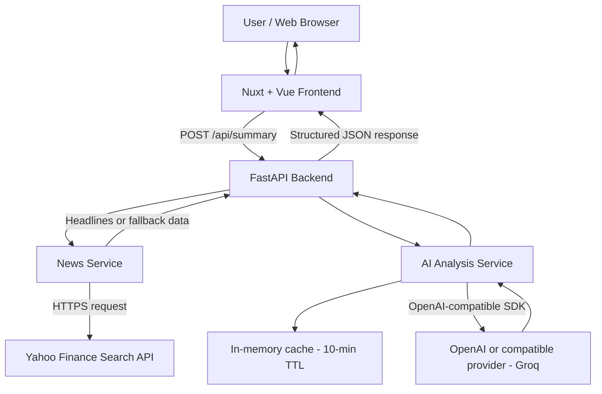

# AI Stock News App

A full-stack app that turns recent stock news into a concise briefing with an executive summary, key takeaways, and headline summaries.

## Tech Stack

- **Frontend:** Nuxt 3, Vue 3, TypeScript, Tailwind CSS
- **Backend:** Python 3.11+, FastAPI, Pydantic
- **News and AI:** Yahoo Finance Search endpoint, OpenAI Python SDK (`gpt-4o-mini` by default)
- **Tests:** pytest and FastAPI TestClient; Node.js `node:test`
- **Deployment:** Docker Compose

## Quick Start (Docker)

Requirements: Docker Engine/Desktop and Docker Compose v2. An API key is needed unless you enter one in the UI (with model (`gpt-4o-mini` by default).

```bash
git clone <REPOSITORY-URL>
cd ai-stock-news-app
cp .env.example .env
```

Set `API_KEY` in `.env`. For the official OpenAI API, leave `BASE_URL` empty. Keep secrets out of version control.

```bash
docker compose up --build
```

Open:

- Frontend: <http://localhost:3000>
- Backend API: <http://localhost:8000>
- API documentation: <http://localhost:8000/docs>
- Health check: <http://localhost:8000/health>

Stop the app with `docker compose down`.

Die Frontend-Container-Konfiguration verwendet `http://localhost:8000`, da der Browser des Nutzers die API aufruft. Das ist absichtlich nicht `http://backend:8000`: Der Compose-Service-Name ist nur innerhalb des Docker-Netzwerks auflösbar, nicht im Browser des Host-Computers.

## Local Development (without Docker)

### Backend

From the project root:

```bash
python -m venv .venv
# macOS/Linux
source .venv/bin/activate
# Windows PowerShell: .venv\Scripts\Activate.ps1
python -m pip install -r backend/requirements.txt
cp .env.example .env
# Set API_KEY in .env
cd backend
uvicorn main:app --reload --port 8000
```

The summary endpoint is `POST /api/summary`. Example request:

```json
{
  "ticker": "AAPL",
  "api_key": null
}
```

`api_key` is optional when `API_KEY` is set in the environment.

### Frontend

In a second terminal:

```bash
cd frontend
npm ci
npm run dev
```

Default URL: <http://localhost:3000>. Override the backend URL with `NUXT_PUBLIC_API_BASE_URL` (default: `http://localhost:8000`).

## Tests

Tests mock external news and AI calls, so a live API key is not required.

```bash
# Backend
cd backend
python -m pip install -r requirements.txt
python -m pytest -v

# Frontend, in a separate terminal
cd frontend
npm ci
npm test
```

Backend coverage report (requires `pytest-cov`):

```bash
python -m pytest --cov=. --cov-report=term-missing
```

Frontend tests use Node's built-in `node:test` runner. They cover ticker normalization, request construction, and API error messages. They are unit tests, not browser end-to-end tests.

### Tests in Docker

```bash
docker compose run --build --rm backend sh -lc 'python -m pip install pytest-cov && python -m pytest -v'
```

Frontend tests run only locally in `frontend`-folder, container-image only contains ready Nuxt-Build.

## Fine Concept

### Goal

- Provide a quick news briefing for a stock ticker.
- Collect recent headlines and turn them into a short, readable summary.
- Show an overall summary, key takeaways, and a short summary for each headline.
- Help users understand recent news; the application does not provide investment advice.

### Main user flow

- The user enters a ticker symbol in the web interface.
- The frontend sends the ticker and an optional API key to the backend.
- The backend normalizes the ticker and requests recent news.
- The AI service sends the headlines to the configured OpenAI-compatible model.
- The backend returns structured JSON to the frontend.
- The frontend displays the briefing and links to the original news when available.

### Main components

- **Frontend:** Nuxt and Vue provide the form and results UI.
- **API:** FastAPI validates requests and coordinates the services.
- **News service:** retrieves headlines from Yahoo Finance and currently returns clearly documented fallback/demo headlines if retrieval fails.
- **AI service:** asks the configured model to return a structured summary and enriches the news items with individual summaries.
- **Configuration:** environment variables select the API key, model, and optional API base URL. An empty `BASE_URL` uses the OpenAI SDK default endpoint.
- **Cache:** the AI service keeps results in a process-local in-memory cache for 10 minutes.
- **Deployment:** Docker Compose starts the frontend and backend as separate services.

## Architecture



The browser calls the backend at `http://localhost:8000` in the default local setup. Provider API keys are used by the backend and should not be embedded in frontend code.

## Project Structure

```text
.
├── backend/
│   ├── main.py
│   ├── config.py
│   ├── models.py
│   ├── services/
│   │   ├── ai_service.py
│   │   └── news_service.py
│   ├── tests/
│   ├── requirements.txt
│   └── Dockerfile
├── frontend/
│   ├── components/
│   ├── tests/
│   ├── utils.mjs
│   ├── package.json
│   └── Dockerfile
├── docs/
│   ├── FINE_CONCEPT_AND_BLUEPRINT.md
│   └── TRADE_OFFS_AND_DECISIONS.md
├── docker-compose.yml
├── .env.example
└── README.md
```

## Troubleshooting

- **Frontend cannot reach the API:** Check `docker compose ps` and confirm `NUXT_PUBLIC_API_BASE_URL` is `http://localhost:8000`.
- **API key error:** Set `API_KEY` in `.env` or enter a valid key in the UI; restart the containers after changing environment values.
- **Port conflict:** Ensure ports `3000` and `8000` are available, or change the Compose port mappings.
- **Health check fails:** Inspect `docker compose logs backend` and open `/health`.
